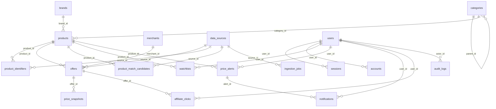

# PriceLens — Database Design & Schema Specification (`DATABASE.md`)

**Database Engine:** PostgreSQL 16+  
**ORM & Migration Tooling:** Drizzle ORM (`drizzle-orm/pg-core`) + `drizzle-kit`  
**Primary Keys:** Native `UUID` (`gen_random_uuid()`) across all tables  
**Monetary Values:** `NUMERIC(12, 2)` (never `FLOAT`/`REAL`)  
**Timestamps:** `TIMESTAMPTZ` (`timestamp(..., { withTimezone: true })`) stored in UTC

---

## 1. Entity-Relationship Diagram

---

## 2. Important Schema Design Decisions

1. **Canonical Products vs. Merchant Offers (`products` vs. `offers`):**
   - `products` represents the merchant-agnostic, verified physical model/variant (e.g., *Apple iPhone 16 Pro 256GB Natural Titanium*).
   - `offers` represents a specific merchant's listing for that product from a specific data source at a given price and stock state. Keeping these separated allows multiple merchants (and even multiple listings/feeds) to map cleanly to one canonical product page without duplicating catalog metadata.
2. **Current Offer State vs. Append-Only Historical Snapshots (`offers` vs. `price_snapshots`):**
   - `offers` holds the latest known state for fast comparison queries (`O(1)` lookup per merchant offer).
   - `price_snapshots` is strictly append-only. Updating an offer's price or availability **never** overwrites or deletes historical rows in `price_snapshots`.
3. **Explicit `NULL` Handling for `shipping_cost` and `total_price`:**
   - `shipping_cost` is nullable `NUMERIC(12, 2)`. A value of `0.00` means verified free shipping; `NULL` means shipping cost is unknown.
   - A PostgreSQL `CHECK` constraint enforces:
     `(shipping_cost IS NULL AND total_price IS NULL) OR (shipping_cost IS NOT NULL AND total_price = price + shipping_cost)`
     This guarantees at the database engine level that `total_price` is never fabricated when `shipping_cost` is unknown.
4. **Scoped Identifier Uniqueness (`product_identifiers`):**
   - Global standards (`GTIN`, `EAN`, `UPC`) are unique across `(type, value)` where `source_id IS NULL`, while source-scoped identifiers (`SKU`, feed-specific `MPN`) are unique across `(type, value, source_id)` using PostgreSQL `NULLS NOT DISTINCT`.
5. **Source Freshness Protection:**
   - `offers` tracks both `source_updated_at` (when the source generated the record, if provided) and `last_checked_at` (when PriceLens ingested/verified it). Upsert queries reject incoming rows where `source_updated_at < offers.source_updated_at` so delayed queues cannot overwrite newer prices with older prices.
6. **Future Partitioning of `price_snapshots`:**
   - `price_snapshots` is the highest-growth table. Its primary key is composite `(id, recorded_at)` (or indexed by `(offer_id, recorded_at DESC)`), allowing declarative PostgreSQL `PARTITION BY RANGE (recorded_at)` by month/quarter without application query changes.
7. **Unified Better Auth Schema with Native UUIDs:**
   - Rather than maintaining two separate user tables, Better Auth is configured with `advanced.database.generateId: "uuid"` and mapped directly to `users`, `sessions`, `accounts`, and `verifications` with `role` (`'user' | 'admin'`).

---

## 3. Table Specifications

### 3.1 `categories`
Hierarchical product taxonomy supporting unlimited nesting via `parent_id`.
- `id`: `UUID` PK (`defaultRandom()`)
- `parent_id`: `UUID` Nullable FK $\rightarrow$ `categories.id` (`ON DELETE SET NULL`)
- `name`: `TEXT` NOT NULL
- `slug`: `TEXT` NOT NULL UNIQUE
- `created_at`: `TIMESTAMPTZ` NOT NULL DEFAULT `now()`
- `updated_at`: `TIMESTAMPTZ` NOT NULL DEFAULT `now()`
- **Indexes:** `categories_slug_uq` (UNIQUE on `slug`), `categories_parent_id_idx` (`parent_id`)

### 3.2 `brands`
- `id`: `UUID` PK (`defaultRandom()`)
- `name`: `TEXT` NOT NULL UNIQUE
- `slug`: `TEXT` NOT NULL UNIQUE
- `created_at`: `TIMESTAMPTZ` NOT NULL DEFAULT `now()`
- `updated_at`: `TIMESTAMPTZ` NOT NULL DEFAULT `now()`
- **Indexes:** `brands_slug_uq` (UNIQUE on `slug`), `brands_name_idx` (`name`)

### 3.3 `products`
Canonical product entities. Each distinct variant (capacity, RAM, color, condition) is a distinct row.
- `id`: `UUID` PK (`defaultRandom()`)
- `category_id`: `UUID` NOT NULL FK $\rightarrow$ `categories.id` (`ON DELETE RESTRICT`)
- `brand_id`: `UUID` NOT NULL FK $\rightarrow$ `brands.id` (`ON DELETE RESTRICT`)
- `name`: `TEXT` NOT NULL
- `slug`: `TEXT` NOT NULL UNIQUE
- `model`: `TEXT` Nullable (normalized manufacturer model code, e.g., `A3293`)
- `description`: `TEXT` Nullable
- `image_url`: `TEXT` Nullable
- `attributes`: `JSONB` NOT NULL DEFAULT `'{}'::jsonb` (structured attributes: `color`, `storage_capacity`, `ram`, `cpu`, `gpu`, `size`, `condition`, `variant`, `is_demo`)
- `status`: `TEXT` NOT NULL DEFAULT `'active'` (`CHECK (status IN ('active', 'draft', 'archived'))`)
- `created_at`: `TIMESTAMPTZ` NOT NULL DEFAULT `now()`
- `updated_at`: `TIMESTAMPTZ` NOT NULL DEFAULT `now()`
- **Indexes:**
  - `products_slug_uq` (UNIQUE on `slug`)
  - `products_category_status_idx` (`category_id`, `status`)
  - `products_brand_model_idx` (`brand_id`, `model`)
  - `products_attributes_gin_idx` (GIN index on `attributes`)

### 3.4 `product_identifiers`
Standardized and source-scoped product lookup keys.
- `id`: `UUID` PK (`defaultRandom()`)
- `product_id`: `UUID` NOT NULL FK $\rightarrow$ `products.id` (`ON DELETE CASCADE`)
- `type`: `TEXT` NOT NULL (`CHECK (type IN ('GTIN', 'EAN', 'UPC', 'BARCODE', 'MPN', 'SKU'))`)
- `value`: `TEXT` NOT NULL (normalized uppercase/trimmed string)
- `source_id`: `UUID` Nullable FK $\rightarrow$ `data_sources.id` (`ON DELETE SET NULL`)
- `created_at`: `TIMESTAMPTZ` NOT NULL DEFAULT `now()`
- **Constraints & Indexes:**
  - `product_identifiers_type_value_source_uq`: UNIQUE (`type`, `value`, `source_id`) `NULLS NOT DISTINCT`
  - `product_identifiers_lookup_idx`: (`type`, `value`)
  - `product_identifiers_product_id_idx`: (`product_id`)

### 3.5 `merchants`
- `id`: `UUID` PK (`defaultRandom()`)
- `name`: `TEXT` NOT NULL
- `slug`: `TEXT` NOT NULL UNIQUE
- `website`: `TEXT` NOT NULL
- `logo_url`: `TEXT` Nullable
- `verification_status`: `TEXT` NOT NULL DEFAULT `'unknown'` (`CHECK (verification_status IN ('verified', 'unverified', 'unknown'))`)
- `status`: `TEXT` NOT NULL DEFAULT `'active'` (`CHECK (status IN ('active', 'inactive'))`)
- `created_at`: `TIMESTAMPTZ` NOT NULL DEFAULT `now()`
- `updated_at`: `TIMESTAMPTZ` NOT NULL DEFAULT `now()`

### 3.6 `data_sources`
Authorized ingestion feeds. **Never stores plaintext API keys or secrets.**
- `id`: `UUID` PK (`defaultRandom()`)
- `name`: `TEXT` NOT NULL
- `source_type`: `TEXT` NOT NULL (`CHECK (source_type IN ('csv', 'merchant_feed', 'affiliate_api', 'mock'))`)
- `configuration`: `JSONB` NOT NULL DEFAULT `'{}'::jsonb` (stores non-secret adapter settings such as feed URL, CSV delimiter, column mapping, or env var key reference name)
- `status`: `TEXT` NOT NULL DEFAULT `'active'` (`CHECK (status IN ('active', 'paused', 'disabled'))`)
- `created_at`: `TIMESTAMPTZ` NOT NULL DEFAULT `now()`
- `updated_at`: `TIMESTAMPTZ` NOT NULL DEFAULT `now()`

### 3.7 `offers`
Current merchant listings linked to a canonical product.
- `id`: `UUID` PK (`defaultRandom()`)
- `product_id`: `UUID` NOT NULL FK $\rightarrow$ `products.id` (`ON DELETE RESTRICT`)
- `merchant_id`: `UUID` NOT NULL FK $\rightarrow$ `merchants.id` (`ON DELETE RESTRICT`)
- `source_id`: `UUID` NOT NULL FK $\rightarrow$ `data_sources.id` (`ON DELETE RESTRICT`)
- `external_product_id`: `TEXT` NOT NULL
- `title`: `TEXT` NOT NULL
- `product_url`: `TEXT` NOT NULL
- `affiliate_url`: `TEXT` Nullable
- `price`: `NUMERIC(12, 2)` NOT NULL
- `currency`: `VARCHAR(3)` NOT NULL DEFAULT `'THB'`
- `shipping_cost`: `NUMERIC(12, 2)` Nullable
- `total_price`: `NUMERIC(12, 2)` Nullable
- `availability_status`: `TEXT` NOT NULL DEFAULT `'unknown'` (`CHECK (availability_status IN ('in_stock', 'out_of_stock', 'preorder', 'unknown'))`)
- `condition`: `TEXT` NOT NULL DEFAULT `'new'` (`CHECK (condition IN ('new', 'refurbished', 'used', 'unknown'))`)
- `source_updated_at`: `TIMESTAMPTZ` Nullable (preserved source timestamp)
- `last_checked_at`: `TIMESTAMPTZ` NOT NULL DEFAULT `now()`
- `status`: `TEXT` NOT NULL DEFAULT `'active'` (`CHECK (status IN ('active', 'stale', 'inactive'))`)
- `created_at`: `TIMESTAMPTZ` NOT NULL DEFAULT `now()`
- `updated_at`: `TIMESTAMPTZ` NOT NULL DEFAULT `now()`
- **Constraints & Indexes:**
  - `offers_source_external_uq`: UNIQUE (`source_id`, `external_product_id`)
  - `offers_price_positive_chk`: `CHECK (price >= 0)`
  - `offers_shipping_positive_chk`: `CHECK (shipping_cost IS NULL OR shipping_cost >= 0)`
  - `offers_total_price_integrity_chk`: `CHECK ((shipping_cost IS NULL AND total_price IS NULL) OR (shipping_cost IS NOT NULL AND total_price = price + shipping_cost))`
  - `offers_product_status_price_idx`: (`product_id`, `status`, `price` ASC)
  - `offers_product_total_price_idx`: (`product_id`, `status`, `total_price` ASC NULLS LAST)
  - `offers_merchant_id_idx`: (`merchant_id`)

### 3.8 `price_snapshots`
Append-only historical price and availability log. Never deleted when offers update.
- `id`: `UUID` PK (`defaultRandom()`)
- `offer_id`: `UUID` NOT NULL FK $\rightarrow$ `offers.id` (`ON DELETE RESTRICT`)
- `price`: `NUMERIC(12, 2)` NOT NULL (`CHECK (price >= 0)`)
- `shipping_cost`: `NUMERIC(12, 2)` Nullable (`CHECK (shipping_cost IS NULL OR shipping_cost >= 0)`)
- `total_price`: `NUMERIC(12, 2)` Nullable (`CHECK ((shipping_cost IS NULL AND total_price IS NULL) OR (shipping_cost IS NOT NULL AND total_price = price + shipping_cost))`)
- `currency`: `VARCHAR(3)` NOT NULL DEFAULT `'THB'`
- `availability_status`: `TEXT` NOT NULL (`CHECK (availability_status IN ('in_stock', 'out_of_stock', 'preorder', 'unknown'))`)
- `recorded_at`: `TIMESTAMPTZ` NOT NULL DEFAULT `now()`
- **Indexes:**
  - `price_snapshots_offer_recorded_idx`: (`offer_id`, `recorded_at` DESC)
  - `price_snapshots_recorded_at_brin_idx`: BRIN index on `recorded_at` (for time-range scans and partition pruning)

### 3.9 `product_match_candidates`
Holds uncertain or pending product match candidates for Admin review, as well as audit records of match decisions.
- `id`: `UUID` PK (`defaultRandom()`)
- `product_id`: `UUID` Nullable FK $\rightarrow$ `products.id` (`ON DELETE SET NULL`)
- `source_id`: `UUID` NOT NULL FK $\rightarrow$ `data_sources.id` (`ON DELETE CASCADE`)
- `external_product_id`: `TEXT` NOT NULL
- `candidate_data`: `JSONB` NOT NULL (normalized incoming offer & extracted product attributes)
- `confidence_score`: `NUMERIC(5, 2)` NOT NULL (`CHECK (confidence_score >= 0 AND confidence_score <= 100)`)
- `matching_reasons`: `JSONB` NOT NULL DEFAULT `'[]'::jsonb` (array of structured rule explanations, e.g., `["EXACT_BRAND_MATCH", "TITLE_SIMILARITY_0.82", "MISSING_GTIN_REQUIRES_REVIEW"]`)
- `review_status`: `TEXT` NOT NULL DEFAULT `'pending'` (`CHECK (review_status IN ('pending', 'approved', 'rejected'))`)
- `created_at`: `TIMESTAMPTZ` NOT NULL DEFAULT `now()`
- `reviewed_at`: `TIMESTAMPTZ` Nullable
- **Constraints & Indexes:**
  - `match_candidates_source_ext_product_uq`: UNIQUE (`source_id`, `external_product_id`, `product_id`) `NULLS NOT DISTINCT`
  - `match_candidates_review_status_idx`: (`review_status`, `confidence_score` DESC)

### 3.10 Authentication Tables (`users`, `sessions`, `accounts`, `verifications`)
Managed by Better Auth's Drizzle PostgreSQL adapter with UUID primary keys:
- `users`: `id` (`UUID` PK), `name` (`TEXT` NOT NULL), `email` (`TEXT` NOT NULL UNIQUE), `email_verified` (`BOOLEAN` NOT NULL DEFAULT `false`), `image` (`TEXT`), `role` (`TEXT` NOT NULL DEFAULT `'user'` CHECK ` IN ('user', 'admin')`), `created_at` (`TIMESTAMPTZ`), `updated_at` (`TIMESTAMPTZ`).
- `sessions`: `id` (`UUID` PK), `user_id` (`UUID` FK $\rightarrow$ `users.id` `ON DELETE CASCADE`), `token` (`TEXT` UNIQUE), `expires_at` (`TIMESTAMPTZ`), `ip_address` (`TEXT`), `user_agent` (`TEXT`), `created_at`, `updated_at`.
- `accounts`: `id` (`UUID` PK), `user_id` (`UUID` FK $\rightarrow$ `users.id` `ON DELETE CASCADE`), `account_id` (`TEXT`), `provider_id` (`TEXT`), `access_token`, `refresh_token`, `id_token`, `access_token_expires_at`, `refresh_token_expires_at`, `scope`, `password`, `created_at`, `updated_at`.
- `verifications`: `id` (`UUID` PK), `identifier` (`TEXT`), `value` (`TEXT`), `expires_at` (`TIMESTAMPTZ`), `created_at`, `updated_at`.

### 3.11 `watchlists`
- `id`: `UUID` PK (`defaultRandom()`)
- `user_id`: `UUID` NOT NULL FK $\rightarrow$ `users.id` (`ON DELETE CASCADE`)
- `product_id`: `UUID` NOT NULL FK $\rightarrow$ `products.id` (`ON DELETE CASCADE`)
- `created_at`: `TIMESTAMPTZ` NOT NULL DEFAULT `now()`
- **Constraints:** `watchlists_user_product_uq` UNIQUE (`user_id`, `product_id`)

### 3.12 `price_alerts`
- `id`: `UUID` PK (`defaultRandom()`)
- `user_id`: `UUID` NOT NULL FK $\rightarrow$ `users.id` (`ON DELETE CASCADE`)
- `product_id`: `UUID` NOT NULL FK $\rightarrow$ `products.id` (`ON DELETE CASCADE`)
- `target_price`: `NUMERIC(12, 2)` NOT NULL (`CHECK (target_price > 0)`)
- `currency`: `VARCHAR(3)` NOT NULL DEFAULT `'THB'`
- `is_active`: `BOOLEAN` NOT NULL DEFAULT `true`
- `last_notified_at`: `TIMESTAMPTZ` Nullable
- `created_at`: `TIMESTAMPTZ` NOT NULL DEFAULT `now()`
- `updated_at`: `TIMESTAMPTZ` NOT NULL DEFAULT `now()`
- **Constraints & Indexes:**
  - `price_alerts_user_product_uq`: UNIQUE (`user_id`, `product_id`)
  - `price_alerts_active_product_idx`: (`product_id`, `is_active`, `target_price`)

### 3.13 `notifications`
- `id`: `UUID` PK (`defaultRandom()`)
- `user_id`: `UUID` NOT NULL FK $\rightarrow$ `users.id` (`ON DELETE CASCADE`)
- `alert_id`: `UUID` NOT NULL FK $\rightarrow$ `price_alerts.id` (`ON DELETE CASCADE`)
- `channel`: `TEXT` NOT NULL DEFAULT `'email'` (`CHECK (channel IN ('email', 'push'))`)
- `status`: `TEXT` NOT NULL (`CHECK (status IN ('pending', 'sent', 'failed', 'suppressed_duplicate'))`)
- `message`: `TEXT` NOT NULL
- `sent_at`: `TIMESTAMPTZ` Nullable
- `created_at`: `TIMESTAMPTZ` NOT NULL DEFAULT `now()`
- **Indexes:** `notifications_user_created_idx` (`user_id`, `created_at` DESC), `notifications_alert_id_idx` (`alert_id`)

### 3.14 `affiliate_clicks`
- `id`: `UUID` PK (`defaultRandom()`)
- `user_id`: `UUID` Nullable FK $\rightarrow$ `users.id` (`ON DELETE SET NULL`)
- `offer_id`: `UUID` NOT NULL FK $\rightarrow$ `offers.id` (`ON DELETE RESTRICT`)
- `affiliate_source`: `TEXT` NOT NULL
- `tracking_id`: `TEXT` NOT NULL UNIQUE
- `clicked_at`: `TIMESTAMPTZ` NOT NULL DEFAULT `now()`
- **Indexes:** `affiliate_clicks_offer_clicked_idx` (`offer_id`, `clicked_at` DESC), `affiliate_clicks_user_id_idx` (`user_id`)

### 3.15 `ingestion_jobs`
- `id`: `UUID` PK (`defaultRandom()`)
- `source_id`: `UUID` NOT NULL FK $\rightarrow$ `data_sources.id` (`ON DELETE RESTRICT`)
- `job_type`: `TEXT` NOT NULL (`CHECK (job_type IN ('csv_import', 'scheduled_sync', 'manual_sync', 'alert_evaluation'))`)
- `status`: `TEXT` NOT NULL DEFAULT `'queued'` (`CHECK (status IN ('queued', 'running', 'completed', 'failed', 'partial'))`)
- `started_at`: `TIMESTAMPTZ` Nullable
- `completed_at`: `TIMESTAMPTZ` Nullable
- `records_processed`: `INTEGER` NOT NULL DEFAULT `0` (`CHECK (records_processed >= 0)`)
- `records_failed`: `INTEGER` NOT NULL DEFAULT `0` (`CHECK (records_failed >= 0)`)
- `error_message`: `TEXT` Nullable
- `created_at`: `TIMESTAMPTZ` NOT NULL DEFAULT `now()`
- **Indexes:** `ingestion_jobs_source_created_idx` (`source_id`, `created_at` DESC), `ingestion_jobs_status_idx` (`status`)

### 3.16 `audit_logs` (Security Requirement — Section 10)
Immutable log of sensitive administrative actions.
- `id`: `UUID` PK (`defaultRandom()`)
- `actor_id`: `UUID` Nullable FK $\rightarrow$ `users.id` (`ON DELETE SET NULL`)
- `action`: `TEXT` NOT NULL (e.g., `'PRODUCT_CREATE'`, `'MATCH_CANDIDATE_APPROVE'`, `'MATCH_CANDIDATE_REJECT'`, `'OFFER_IMPORT'`)
- `entity_type`: `TEXT` NOT NULL
- `entity_id`: `TEXT` NOT NULL
- `metadata`: `JSONB` NOT NULL DEFAULT `'{}'::jsonb`
- `created_at`: `TIMESTAMPTZ` NOT NULL DEFAULT `now()`
