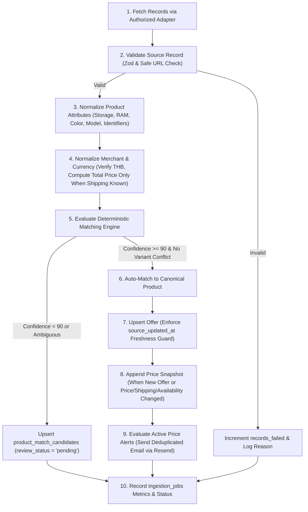

# PriceLens — Data Ingestion & Matching Engine (`DATA_SOURCES.md`)

## 1. Thai Market Data Strategy & Compliance

In the Thai e-commerce ecosystem, public marketplaces (Shopee, Lazada, TikTok Shop) do **not** offer unrestricted public product-comparison APIs to anonymous third parties, and aggressive web scraping violates their Terms of Service.

PriceLens is engineered around **authorized, compliant data channels**:
1. **Manual & Scheduled CSV Imports (`csv-adapter.ts`):** Used for initial catalog seeding, partner price sheets, and verified QA datasets.
2. **Authorized Merchant Product Feeds (`merchant-feed-adapter.ts`):** Structured JSON/XML/CSV catalog feeds provided by specialty Thai retailers (e.g., Advice IT, JIB, Banana IT, Power Buy) and brand-direct stores.
3. **Affiliate Network Data Feeds (`affiliate-adapter.ts`):** Product data feeds and deep-link generators from regional affiliate networks operating in Thailand (e.g., Involve Asia, Accesstrade Thailand, Shopee/Lazada Affiliate Partner APIs where authorized credentials are provisioned).

### Non-Negotiable Ingestion Rules
- **Never** bypass marketplace login walls, CAPTCHAs, or rate limits.
- **Never** fabricate live API connectivity when credentials are absent; clearly distinguish mock/CSV sources from live partner feeds.
- **Never** store API tokens or affiliate secrets in `data_sources.configuration` (use Cloudflare Worker secrets referenced by env variable key name).
- **Never** allow an older source payload (`source_updated_at`) to overwrite a newer offer state in the database.

---

## 2. Modular Adapter Architecture

```text
workers/ingestion/
├── adapters/
│   ├── adapter.interface.ts       # Common DataSourceAdapter contract
│   ├── csv-adapter.ts             # RFC 4180 CSV parser & field mapper
│   ├── merchant-feed-adapter.ts   # Authorized merchant JSON/feed adapter
│   └── affiliate-adapter.ts       # Affiliate feed & tracking URL adapter
├── services/
│   ├── validate.service.ts        # Row-level Zod validation & URL sanitization
│   ├── normalize.service.ts       # Brand, model, attribute & THB price normalization
│   ├── matching.service.ts        # Deterministic product matching engine
│   ├── offer.service.ts           # Idempotent offer upsert with freshness guard
│   └── snapshot.service.ts        # Append-only price snapshot writer
└── jobs/
    ├── import-products.job.ts     # Executes 10-step ingestion pipeline & records job stats
    ├── sync-offers.job.ts         # Scheduled Cron synchronization
    └── price-alert.job.ts         # Evaluates active price alerts & dispatches Resend emails
```

### Common Adapter Interface
```typescript
export interface RawSourceRecord {
  externalProductId: string;
  merchantName: string;
  merchantSlug: string;
  merchantWebsite: string;
  merchantVerified?: boolean | null;
  title: string;
  brandName?: string | null;
  categoryName?: string | null;
  model?: string | null;
  gtin?: string | null;
  ean?: string | null;
  upc?: string | null;
  mpn?: string | null;
  sku?: string | null;
  price: string | number;
  shippingCost?: string | number | null; // null/undefined = unknown; 0 = free shipping
  currency: string;
  availabilityStatus?: "in_stock" | "out_of_stock" | "preorder" | "unknown";
  condition?: "new" | "refurbished" | "used" | "unknown";
  productUrl: string;
  affiliateUrl?: string | null;
  imageUrl?: string | null;
  attributes?: Record<string, string | number | boolean | null>;
  sourceUpdatedAt?: string | null; // ISO-8601 timestamp from source
}

export interface DataSourceAdapter {
  readonly sourceType: "csv" | "merchant_feed" | "affiliate_api" | "mock";
  fetchRecords(config: Record<string, unknown>, payload?: string): Promise<RawSourceRecord[]>;
}
```

---

## 3. The 10-Step Ingestion Pipeline



---

## 4. Deterministic Product Matching Engine (`matching.service.ts`)

The matching engine prevents the most common flaw in price comparison websites: falsely merging different capacities, sizes, colors, or generations into a single listing.

### 4.1 Variant Veto Gate (Pre-Condition for Any Match)
Before any candidate canonical product is accepted, the engine compares normalized differentiating attributes between the incoming record and the canonical product:
- `storage_capacity` (e.g., `128GB` vs. `256GB` vs. `512GB` vs. `1TB`)
- `ram` (e.g., `8GB` vs. `16GB` vs. `32GB`)
- `color` (e.g., `Natural Titanium` vs. `Black Titanium`)
- `size` (e.g., `27-inch` vs. `32-inch`, `41mm` vs. `45mm`)
- `cpu` / `gpu` (e.g., `M3` vs. `M3 Pro`, `RTX 4060` vs. `RTX 4070`)
- `condition` (`new` vs. `refurbished` vs. `used`)
- `variant` (`Wi-Fi` vs. `Wi-Fi + Cellular`)

**Rule:** If both records specify one of these attributes and their normalized values differ, the match is **immediately vetoed** (`CONFLICTING_VARIANT_ATTRIBUTE`), even if the title or MPN is similar.

### 4.2 Matching Priority Hierarchy

| Priority | Rule | Confidence | Action |
| :--- | :--- | :--- | :--- |
| **1. Global Identifier** | Exact match on normalized `GTIN`, `EAN`, `UPC`, or `BARCODE` + passes Variant Veto Gate | **`100.00`** | **Auto-Link** to canonical product |
| **2. Manufacturer Part Number (MPN)** | Exact match on normalized `MPN` + matching `brand` + passes Variant Veto Gate | **`95.00`** | **Auto-Link** to canonical product |
| **3. Brand + Model + Complete Variant Attributes** | Exact `brand` + exact `model` code + at least 2 matching variant attributes + zero variant conflicts | **`90.00`** | **Auto-Link** to canonical product |
| **4. Normalized Title + Attribute Overlap** | Same `brand` + high token Jaccard similarity ($\ge 0.70$) on normalized title + no variant conflict, but missing GTIN/MPN/Model | **`60.00 – 84.00`** | **Queue for Admin Review** (`review_status = 'pending'`) |
| **5. Partial Brand/Category + Attribute Match** | Same `brand` and `category` with partial model/attribute overlap | **`40.00 – 59.00`** | **Queue for Admin Review** (`review_status = 'pending'`) |
| **6. No Match Found** | No existing product shares identifiers, model, or sufficient title/attribute similarity | **`0.00`** | Queue in `product_match_candidates` for Admin to either create a new canonical product or link manually |

---

## 5. Idempotency, Freshness & Dead-Letter Handling

1. **Offer Upsert Idempotency:** Offers are uniquely keyed by `(source_id, external_product_id)`. Re-importing the exact same CSV or feed updates `last_checked_at` without creating duplicate offers.
2. **Stale Payload Protection:** If an incoming record contains `source_updated_at` older than the stored `offers.source_updated_at`, the offer's price and availability are **not** overwritten.
3. **Snapshot Deduplication:** A new row in `price_snapshots` is inserted only when:
   - The offer is newly created, OR
   - `price`, `shipping_cost`, or `availability_status` changed since the latest snapshot for that offer, OR
   - More than 24 hours have elapsed since the latest snapshot (daily heartbeat snapshot for continuous chart rendering).
4. **Retry & Dead-Letter Queue (DLQ):** Queue messages retry up to 3 times with exponential backoff on transient database or network errors, then route to `ingestion-dlq` and mark the `ingestion_jobs` row as `failed` with diagnostic error output.
