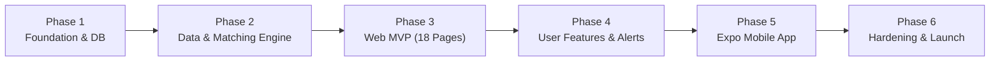

# PriceLens — Development Roadmap & Implementation Plan (`ROADMAP.md`)

## 1. Phased Delivery Plan

We develop PriceLens in **6 small, independently verifiable phases**. Every phase ends with automated type checking, unit/integration tests, and build verification before moving to the next.



---

### Phase 1 — Foundation (First Milestone)
**Goal:** Initialize the monorepo, PostgreSQL schema & migrations, shared validation/business packages, Better Auth authentication, and core `/api/v1` public/admin scaffolding.
- [ ] Initialize Git repository, `pnpm-workspace.yaml`, root `package.json`, `tsconfig.base.json`, `.env.example`, and `docker-compose.yml` (PostgreSQL 16).
- [ ] Build `packages/shared` (ISO currencies, status enums, formatting utilities).
- [ ] Build `packages/database` (Drizzle ORM schema for all 16 tables, constraints, indexes, migrations, and clearly labeled `[DEMO DATA]` seed script for Thai electronics catalog).
- [ ] Build `packages/validation` (Zod schemas for products, offers, history, watchlist, price alerts, admin imports, and match candidates).
- [ ] Build `workers/api` with Hono, Better Auth (`/api/auth/*`), RBAC middleware (`requireAuth`, `requireAdmin`), rate limiting, consistent error envelopes, and OpenAPI `/api/v1/openapi.json` generation.
- [ ] Write & pass Phase 1 unit and API integration tests (Auth, RBAC, catalog queries).

### Phase 2 — Data Ingestion & Matching Engine
**Goal:** Build the deterministic product matching engine, total price calculator, normalization services, and adapter pipeline.
- [ ] Build `packages/business`:
  - Price & Total Cost calculator (`total_price = price + shipping_cost` strictly when shipping is known; `null` when unknown).
  - Product & Attribute normalizer (storage, RAM, color, condition, model, GTIN/EAN/MPN normalization).
  - Deterministic Product Matching Engine (Priority 1–5 + Variant Veto Gate + confidence score & reasons generator).
  - Price history aggregator & Buy/Wait signal evaluator.
- [ ] Build `workers/ingestion`:
  - `csv-adapter.ts`, `merchant-feed-adapter.ts`, `affiliate-adapter.ts`.
  - 10-step idempotent ingestion pipeline (`import-products.job.ts`, `sync-offers.job.ts`).
  - Admin endpoints for CSV/feed import (`POST /api/v1/admin/offers/import`), job monitoring (`GET /api/v1/admin/ingestion-jobs`), and match candidate approval/rejection (`POST /api/v1/admin/match-candidates/:id/approve|reject`).
- [ ] Write comprehensive tests for all edge cases: missing shipping costs, conflicting product variants (e.g., 256GB vs 512GB), duplicate identifiers, outdated offer timestamps, currency mismatch rejection, and malformed URLs/rows.

### Phase 3 — Web MVP (Public Discovery, Comparison, History & Admin UI)
**Goal:** Build `packages/api-client` and `apps/web` (Next.js App Router, Tailwind CSS, `shadcn/ui`) covering discovery, comparison, price history, and admin management.
- [ ] Build `packages/api-client` (typed client for all `/api/v1` endpoints).
- [ ] Build Public Pages (Pages 1–7):
  - Homepage, Search Results with facet filters & sorting, Category Page, Brand Page, and SEO-friendly Product Detail Page (with JSON-LD `Product` schema, Price Comparison table, and 7d/30d/90d/365d Price History chart + empty state).
- [ ] Build Auth & Admin Pages (Pages 8, 9, 13–18):
  - Login, Register, Admin Dashboard, Product Management, Merchant Management, Data Source Management (with CSV import UI), Matching Review Queue (side-by-side diff & Approve/Reject), and Ingestion Job Monitor + Data Quality Report.
- [ ] Verify WCAG 2.2 AA accessibility (focus rings, keyboard parity, contrast, `tabular-nums`, 320px responsive stress).

### Phase 4 — User Features, Watchlist, Price Alerts & Affiliate Tracking
**Goal:** Complete authenticated shopper workflows and outbound revenue tracking.
- [ ] Implement Watchlist API & UI (`/dashboard`, `/dashboard/watchlist` — Pages 10 & 11).
- [ ] Implement Price Alerts API, UI (`/dashboard/alerts` — Page 12), and `price-alert.job.ts` with Resend email integration and duplicate notification suppression (`last_notified_at` + `notifications` log).
- [ ] Implement Affiliate Click Tracking (`POST/GET /api/v1/offers/:id/click`) with `affiliate_clicks` persistence and safe URL redirection.
- [ ] Implement Account Deletion workflow (`DELETE /api/v1/me`) and Admin Audit Log viewer.
- [ ] Write & pass tests for watchlist, price alert triggering, duplicate email suppression, and affiliate click logging.

### Phase 5 — Mobile Application (`apps/mobile`)
**Goal:** Build the Expo / React Native mobile companion app reusing `@pricelens/api-client`, `@pricelens/validation`, and `@pricelens/shared`.
- [ ] Initialize `apps/mobile` with Expo Router and TypeScript.
- [ ] Build Mobile screens: Product Search & Category Browse, Product Detail (Offer Comparison & Price History), Watchlist & Price Alerts, and Push Notification registration hook (prepared for FCM/APNs).
- [ ] Verify type checking and shared package integration across Web and Mobile.

### Phase 6 — Security, Performance & Launch Readiness
**Goal:** End-to-end verification, security audit, performance tuning, and deployment documentation.
- [ ] Complete `docs/DEPLOYMENT.md` covering Cloudflare Workers, R2, Queues, Cron Triggers, Hyperdrive, and Next.js deployment.
- [ ] Run full security checklist (RBAC boundary tests, SQLi/XSS payload tests, rate limit verification, secret hygiene scan).
- [ ] Run full test suite, typecheck, and production build across the entire monorepo.

---

## 2. Technical Risks & Mitigations

| Risk | Impact | Mitigation Strategy |
| :--- | :--- | :--- |
| **1. False-Positive Product Merging** (e.g., merging iPhone 16 Pro 128GB with 256GB) | High — Destroys user trust in price comparison | Enforce hard Variant Veto Gate in `matching.service.ts` before any match is accepted; require `confidence >= 90` with hard identifier/model match for auto-linking; route all title-only matches to `product_match_candidates` for Admin review. |
| **2. Misleading "Lowest Price" Ranking When Shipping is Unknown** | High — Misleads shoppers when a merchant hides high shipping fees | Database `CHECK` constraint enforces `total_price IS NULL` when `shipping_cost IS NULL`. UI and API provide separate sorts for *Lowest Product Price* vs. *Lowest Verified Total Price* (`NULLS LAST`). |
| **3. Out-of-Order Queue Processing Overwriting Fresh Prices** | Medium — Stale prices displayed as current | Compare incoming `source_updated_at` against stored `offers.source_updated_at` in SQL `ON CONFLICT DO UPDATE WHERE`; skip offer state overwrite if incoming record is older. |
| **4. Duplicate Alert Notification Spam** | Medium — Annoys users and wastes Resend email quota | Track `last_notified_at` on `price_alerts` and log every delivery in `notifications`. Suppress notifications if an alert was already triggered within the cooldown window or if the price has not dropped further. |
| **5. High Growth of `price_snapshots` Table** | Medium — Slower historical chart queries over time | Index `(offer_id, recorded_at DESC)` + BRIN index on `recorded_at`, write snapshots only on price/availability change or 24h heartbeat, and design table for declarative range partitioning on `recorded_at`. |

---

## 3. Local Development Commands (Once Phase 1 Is Initialized)

```bash
# 1. Enable pnpm via Corepack (included with Node.js 24)
corepack enable

# 2. Install workspace dependencies
pnpm install

# 3. Start local PostgreSQL 16 container
docker compose up -d

# 4. Copy environment variables
cp .env.example .env

# 5. Run Drizzle database migrations & seed labeled demo data
pnpm --filter @pricelens/database db:migrate
pnpm --filter @pricelens/database db:seed

# 6. Start API Worker, Ingestion Worker, and Next.js Web App in parallel
pnpm dev

# 7. Run typecheck and automated test suite across all packages
pnpm typecheck
pnpm test
```
